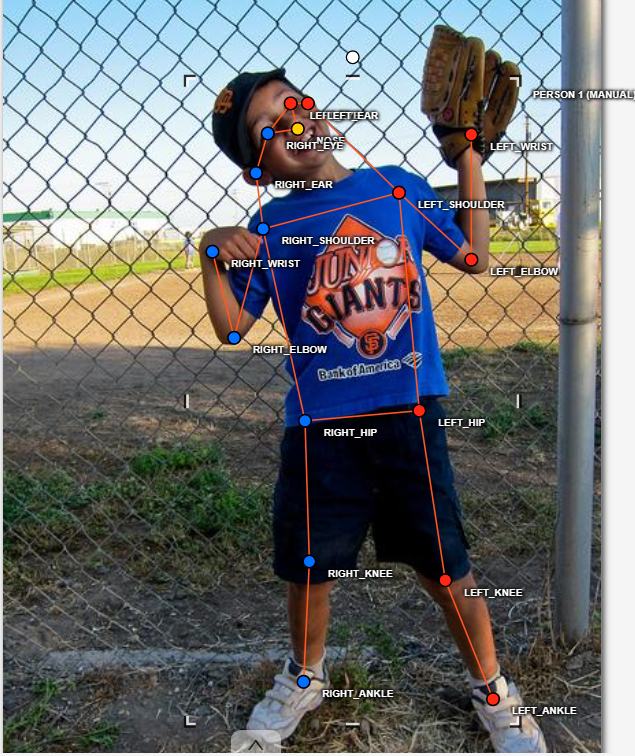
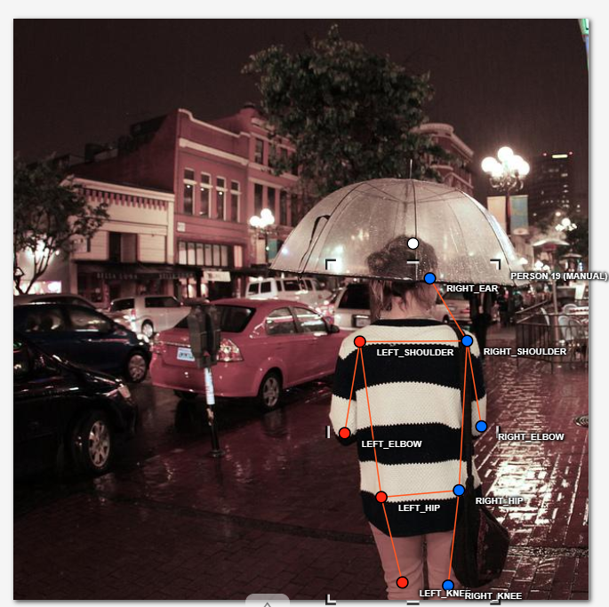
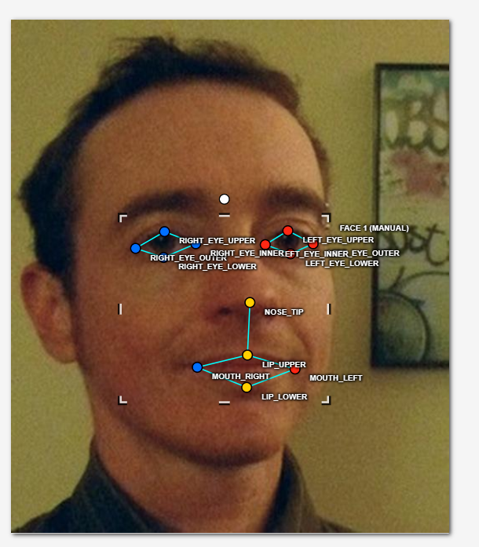
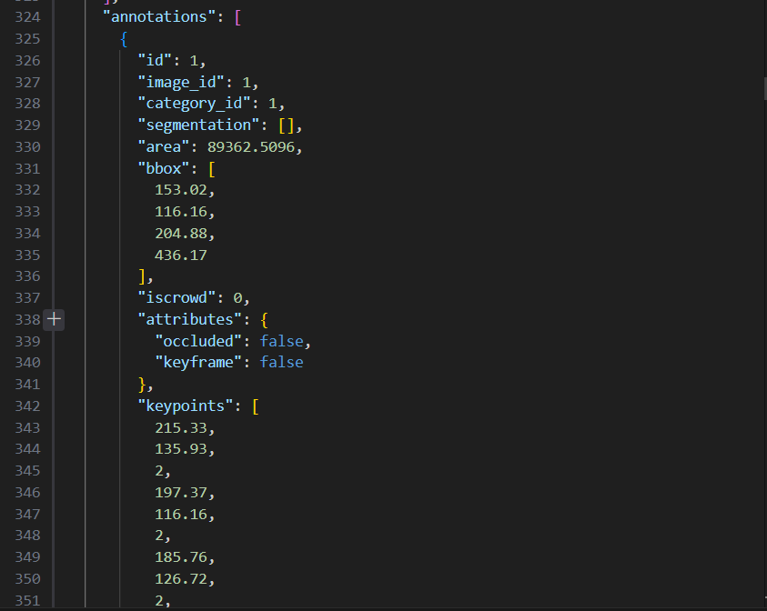

# Báo cáo cá nhân — 202603267_BachSyNui

Dữ liệu: 12 ảnh người COCO val2017 (Lin et al., 2014) và 8 ảnh chân dung Wikimedia Commons, chỉ dùng trong lớp.

## 0. Thông tin học viên

- Họ tên: Bạch Sỹ Núi (BachSyNui)
- MSSV: 202603267
- Email: nuibach1007@gmail.com
- Link repository: https://github.com/nuibachcode/K5-L2B-DAY04-BachSyNui-2A202603267-KeypointPose-Student
- Phiên bản CVAT (Help → About): 2.82.0
- Máy: hệ điều hành Windows 10/11 · RAM 16 GB · chạy CVAT chế độ đầy đủ
- Bộ ảnh (`src/exports/assignment.json` do `lab.py setup` tạo): có
- Giờ bắt đầu: 16:30
- Giờ kết thúc: 18:30

## 1. Kiểm tra label (CP0)

| Label | Kiểu | Số điểm | Tên điểm đúng bảng của lab? | Đúng thứ tự? | Số cạnh |
|---|---|---:|---|---|---:|
| `person` | Skeleton | 17 | Có | Có | 19 |
| `face` | Skeleton | 13 | Có | Có | 13 |

Mẫu `person` dựng theo người quay mặt về camera (các điểm `left_*` nằm bên phải khung mẫu)? Có

Cách đổi cờ `occluded` / `outside` cho **một điểm** trên phiên bản CVAT này (một câu):
Rê chuột vào điểm cần đổi rồi nhấn phím `Q` để chuyển sang `occluded` (`v = 1`, nét đứt/vòng tròn rỗng) hoặc nhấn phím `O` để chuyển sang `outside` (`v = 0`, ẩn điểm), hoặc nhấp chuột phải vào điểm để chọn cờ.

## 2. Số lượng đã gán và thời gian (CP1, CP2)

| Nhóm ảnh | Số ảnh | Số skeleton đã gán | Số người dưới 60 px (không gán) | Số poster / gương / màn hình bỏ qua | Thời gian (phút) |
|---|---:|---:|---:|---:|---:|
| `easy` | 5 | 5 | 0 | 0 | 25 |
| `occluded` | 3 | 6 | 0 | 0 | 20 |
| `back` | 2 | 3 | 0 | 0 | 15 |
| `small` | 1 | 3 | 1 | 0 | 12 |
| `crowd` | 1 | 3 | 2 | 0 | 18 |
| `faces` | 8 | 8 | — | 0 | 25 |

- Số ảnh người đã xong ở mốc phút 105: 10 / 10
- Thời gian thực tế (phút): CP1 90 · CP2 25 · CP3 15
- Ảnh tốn thời gian nhất là ảnh nào, vì sao?
Ảnh `000000272026.jpg` (nhóm crowd) và `000000461002.jpg` (nhóm back) tốn nhiều thời gian nhất vì có nhiều người đứng chen chúc che khuất lẫn nhau, người quay lưng phải thực hiện đổi bên các điểm trái/phải thủ công trước khi kéo khớp.

## 3. Bảng ca khó (CP1, CP2)

Mỗi điểm bạn phân vân một dòng, nhất là phân vân giữa `v = 1` và `v = 0`, hoặc không chắc hướng người.

| Ảnh | Người / mặt | Điểm | Cờ đã chọn | Phân vân giữa | Lý do chọn |
|---|---|---|---:|---|---|
| `000000179201.jpg` | Người #1 | `left_knee`, `left_ankle` | 1 | `v = 1` và `v = 0` | Chân dưới bị che bởi bàn nhưng thân người hướng xuôi thẳng, vị trí khớp gối và cổ chân ước lượng được chắc chắn. |
| `000000043719.jpg` | Người #1 | `nose`, `left_eye`, `right_eye` | 1 | `v = 1` và `v = 0` | Người quay lưng hoàn toàn không thấy mặt, nhưng hướng nhìn và vùng đầu rõ ràng nên ước lượng được vị trí mắt mũi phía trước. |
| `000000461002.jpg` | Người #2 | `right_ankle` | 0 | `v = 0` và `v = 1` | Chân bị che khuất sâu sau xe cộ, tư thế ngồi không rõ nên không đủ cơ sở để ước lượng chính xác, chọn outside (`v = 0`). |
| `000000269462.jpg` | Người #3 | `left_wrist` | 0 | `v = 0` và `v = 1` | Người ở xa bị cắt qua mép ảnh, cổ tay nằm hoàn toàn ngoài khung ảnh. |
| `face_41666.jpg` | Mặt #1 | `left_eye_*`, `right_eye_*` | 1 | `v = 1` và `v = 2` | Người đeo kính râm màu tối che khuất mí mắt, đặt điểm theo gọng kính và bật cờ occluded. |

## 4. Bảng tự review (CP3)

Đi từ ảnh cuối về ảnh đầu. 5 ảnh người (ít nhất 2 ảnh `back` hoặc `crowd`) và 3 ảnh mặt. Ít nhất 8 dòng, kể cả dòng `ok`. Ghi lỗi trước, sửa sau.

Mã lỗi dùng đúng một trong: `lr_swap`, `vis_flag`, `position`, `missing`, `extra`, `ok`.

| Ảnh | Người / mặt | Điểm | Mã lỗi | Ghi chú | Đã sửa? |
|---|---|---|---|---|---|
| `000000272026.jpg` | Người #1 (crowd) | `left_wrist` | `position` | Cổ tay đặt hơi lệch so với khớp thật | Có |
| `000000269462.jpg` | Người #1 (small) | Toàn bộ | `ok` | Khung xương đúng vị trí, cờ chuẩn | Không cần |
| `000000461002.jpg` | Người #1 (back) | `left_shoulder`, `right_shoulder` | `lr_swap` | Người quay lưng bị nhầm lẫn giữa vai trái và vai phải | Có |
| `000000399983.jpg` | Người #1 (easy) | `wrist` | `position` | Hai tay bắt chéo trước ngực, tinh chỉnh lại tâm cổ tay | Có |
| `000000164659.jpg` | Người #1 (easy) | `left_knee`, `left_ankle` | `vis_flag` | Chân bước chéo bị khuất nhẹ, chuyển cờ occluded | Có |
| `face_505385.jpg` | Mặt #1 | Toàn bộ | `ok` | Đủ 13 điểm mí mắt, khóe miệng chính xác | Không cần |
| `face_41666.jpg` | Mặt #1 | `left_eye_upper`, `left_eye_lower` | `vis_flag` | Kính râm che mắt, cần đặt cờ occluded | Có |
| `face_125051.jpg` | Mặt #1 | Toàn bộ | `ok` | Khóe mắt trong/ngoài và mí mắt đặt chuẩn từng pixel | Không cần |

Tổng hợp số lỗi theo mã:

| `lr_swap` | `vis_flag` | `position` | `missing` | `extra` | `ok` |
|---:|---:|---:|---:|---:|---:|
| 1 | 2 | 2 | 0 | 0 | 3 |

Điểm còn phân vân giữa `v = 1` và `v = 0` (ghi cả hai lựa chọn và lý do chọn):
Tại ảnh `000000461002.jpg` (người quay lưng), bàn chân phải sau bánh xe phân vân giữa `v = 1` (đoán theo cẳng chân) và `v = 0` (bị khuất hoàn toàn). Đã chọn `v = 0` (`outside`) vì không thể ước lượng chắc chắn góc gập của bàn chân, tránh đưa nhãn giả định sai lệch vào model huấn luyện.

## 5. Kiểm file xuất và kết quả tự kiểm (CP4)

Tự kiểm tay trong file JSON:

| File | Người / mặt kiểm (ảnh, thứ tự) | Số phần tử `keypoints` | Điểm `outside` ra `v = 0`, `occluded` ra `v = 1`? | `num_keypoints` khớp? |
|---|---|---:|---|---|
| `BachSyNui_persons.zip` | 000000027565, #1 | 51 | Có | Khớp (17) |
| `BachSyNui_persons.zip` | 000000179201, #1 | 51 | Có | Khớp (15) |
| `BachSyNui_faces.zip` | face_125051, #1 | 39 | Có | Khớp (13) |

Sau khi xuất, CVAT ghi `occluded` thành `v = 1` và `outside` thành `v = 0`. Tọa độ của điểm `outside` trong file là tọa độ cũ (theo cơ chế CVAT 2.x, chuẩn COCO bỏ qua các điểm có `v = 0`).

Hai job đã chuyển sang completed trên CVAT? Có

Dán phần **TÓM TẮT** in ra từ `src/check_submission.py`:

```text
- File person: BachSyNui_persons.zip
  Số ảnh: 12 · số skeleton `person`: 20 · mỗi annotation 51 số
  Skeleton theo ảnh: 000000027565=1, 000000043719=1, 000000164659=1, 000000179201=2, 000000183176=2, 000000269462=3, 000000272026=3, 000000294379=1, 000000302102=2, 000000308257=1, 000000399983=1, 000000461002=2
  Cờ v: v=2 245 (72%) · v=1 31 (9%) · v=0 64 (19%)
  num_keypoints trung bình: 13.8
- File face: BachSyNui_faces.zip
  Số ảnh: 8 · số skeleton `face`: 8 · mỗi annotation 39 số
  Skeleton theo ảnh: face_125051=1, face_145751=1, face_255797=1, face_41666=1, face_469647=1, face_476363=1, face_504911=1, face_505385=1
  Cờ v: v=2 93 (89%) · v=1 11 (11%) · v=0 0 (0%)
  num_keypoints trung bình: 13.0
- Ghi chú: 64 điểm v = 0 vẫn mang tọa độ cũ (CVAT 2.x xuất như vậy; chuẩn COCO ghi 0, 0). Không phải lỗi: điểm v = 0 bị bỏ qua khi huấn luyện và khi chấm.
- Số [LỖI]: 0 · số [CẢNH BÁO]: 3
Kết quả: ĐẠT (đọc lại từng cảnh báo ở trên)
```

Các `[CẢNH BÁO]` còn giữ nguyên và lý do:
- `000000164659.jpg #1` và `000000308257.jpg #1`: Người trong ảnh đang sải bước chân hoặc vắt chéo chân tự nhiên trong sinh hoạt thực tế, dẫn đến cặp knee/ankle nằm ngược phía tọa độ x nhưng đã gán đúng giải phẫu trái/phải của người.
- `000000399983.jpg #1`: Hai tay người vắt chéo phía trước thân người, tọa độ cổ tay bắt chéo thực tế, không phải lỗi đổi nhãn `lr_swap`.

## 6. Ảnh chụp màn hình

1. Label `person` trong label constructor (đủ 17 điểm có tên):

   

2. Một người quay lưng đã gán, cờ đã đặt:

   

3. Một khuôn mặt đã gán 13 điểm, phóng to vùng mắt:

   

4. Một đoạn JSON xuất của một người:

   

Nguồn ảnh: COCO val2017 / Wikimedia Commons.

## 7. Tự đánh giá

1. Lỗi bạn mắc nhiều nhất hôm nay, và cách bạn sẽ tránh ở dự án thật:
Lỗi dễ mắc nhất là nhầm lẫn quy ước Trái/Phải (`lr_swap`) khi đối tượng quay lưng hoặc nhìn nghiêng, vì quán tính mắt nhìn theo màn hình. Cách tránh trong dự án thật: Luôn tự đặt mình vào góc nhìn của đối tượng trước khi kéo điểm, kiểm tra các đường nối xương xem có bị bắt chéo hình chữ X bất thường không, và tiến hành hoán đổi cụm vai/hông trái-phải trước khi tinh chỉnh khớp chi tiết.

2. Một quy tắc bạn đề xuất thêm vào guideline (kèm ảnh ví dụ nếu có):
Đề xuất bổ sung quy định cụ thể về việc xác định cờ visibility cho các khớp mặt (mắt, mũi) khi người quay lưng: nếu góc quay vượt quá 120 độ không thấy mặt, quy định rõ nên đặt `occluded` (`v=1`) hay `outside` (`v=0`) để tạo sự nhất quán tuyệt đối giữa các annotator trong dự án lớn.

3. Nhãn của bạn đi vào model ở đâu? Chọn một lỗi bạn đã sửa và nói nó sẽ làm model học sai thế nào (heatmap, trọng số trong loss, hay bước lật ảnh):
Lỗi `lr_swap` (nhầm trái/phải) ảnh hưởng nghiêm trọng nhất đến quá trình huấn luyện:
- Trong quá trình tăng cường dữ liệu (Data Augmentation), kỹ thuật lật ảnh ngang (Horizontal Flip) sẽ tự động tráo đổi tên các cặp keypoint trái và phải (`left_*` ↔ `right_*`).
- Nếu nhãn ban đầu đã bị gán nhầm, bước lật ảnh sẽ khuếch đại sai sót, khiến mô hình học sai hoàn toàn đặc trưng giải phẫu cơ thể.
- Đồng thời, trên heatmap dự đoán của mô hình (như HRNet, YOLO-Pose), đỉnh heatmap thực tế sẽ đối nghịch với nhãn ground truth, khiến hàm mất mát (loss function) bị phạt cực đại và làm mô hình không hội tụ được.

## 8. Khó khăn và lỗi kỹ thuật
Giai đoạn đầu khi mới thao tác với người quay lưng, bộ khung mẫu mặc định của CVAT bị ngược chiều khiến các đường nối bị xoắn chéo. Sau khi áp dụng mẹo đổi vị trí vai và hông trái/phải trước, tốc độ gán nhãn đã tăng lên đáng kể. Thao tác đặt cờ bằng phím tắt `Q` và `O` trong CVAT rất mượt mà và trực quan.

## 9. Tài liệu tham khảo và công cụ AI đã dùng
- CVAT Documentation và bảng hướng dẫn phím tắt trong `docs/CVAT_CHEATSHEET.md`.
- Sử dụng trợ lý AI Antigravity để tra cứu guideline, hỗ trợ phân tích các cảnh báo từ script `check_submission.py` và giải thích định dạng COCO Keypoints 1.0.

